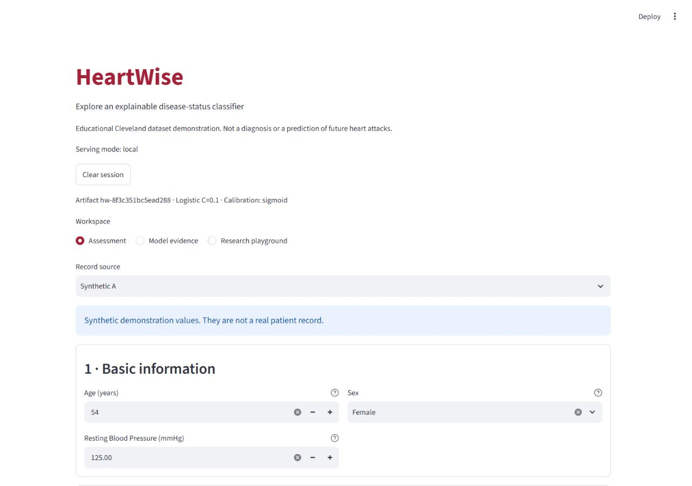
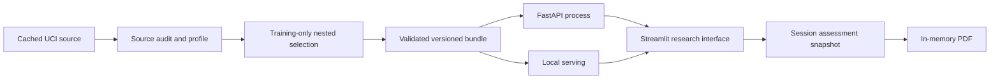

# HeartWise

An explainable educational demonstration of **disease-status classification in the Cleveland dataset**. It does not predict future heart attacks, establish clinical validity, or support consumer screening. Specialist measurements are required.

The corrected build verifies source encodings, selects complete model/calibration procedures using development data only, explains the actual served probability, and ties every assessment and report to a validated immutable artifact.

## Run locally (Windows PowerShell)

Supported runtime: Python 3.12 (tested 3.12.13). The existing `.venv` is isolated from global Python.

```powershell
# Fresh checkout: uv creates an isolated environment; no global package installation.
uv venv --python 3.12 .venv
uv pip install --python .venv/Scripts/python.exe -r requirements.lock
uv pip install --python .venv/Scripts/python.exe --no-deps -e .
.venv/Scripts/python.exe -m src.artifacts validate
.venv/Scripts/python.exe -m streamlit run app/streamlit_app.py
```

On Linux/macOS replace `.venv/Scripts/python.exe` with `.venv/bin/python`. Run setup from the repository directory. The editable installation resolves shared code/data independently of the later working directory. Keep the project directory and its `artifacts` folder together.

Open `http://localhost:8501`. Choose Synthetic A or B, review, assess, inspect contributions and download the PDF. Edits mark the old assessment stale; they do not change its report. Clear session removes the session snapshot.



## API mode

In one terminal:

```powershell
.venv/Scripts/python.exe -m uvicorn api.main:app --host 127.0.0.1 --port 8000 --no-access-log
```

In another:

```powershell
$env:HEARTWISE_MODE='api'
$env:HEARTWISE_API_URL='http://127.0.0.1:8000'
.venv/Scripts/python.exe -m streamlit run app/streamlit_app.py
```

`local` and `api` are the only modes. API errors never trigger local fallback. API mode obtains predictions, model information, evaluation tables and figures from the same service and needs no local artifact files. Restart the API after activating a different bundle; local mode resolves the active artifact on each request.

```powershell
Invoke-RestMethod http://127.0.0.1:8000/ready
Invoke-RestMethod http://127.0.0.1:8000/predict -Method Post -ContentType application/json -Body (Get-Content docs/sample_request.json -Raw)
```

Full synthetic [request](docs/sample_request.json) and [response](docs/sample_response.json) are included. Example response excerpt:

```json
{"artifact_id":"hw-8f3c351bc5ead288","probability":0.024529948343757303,"prediction":0,"threshold":0.5,"calibration":"sigmoid","domain_status":"within_observed_ranges"}
```

`GET /health` is liveness; `GET /ready` runs an inference canary and returns 503 on failure. `/model-info`, `/evaluation`, `/figures/{filename}` and `/docs` describe the serving artifact. `POST /predict?explain=false` omits optional explanation work. Errors omit submitted values and internal paths. API version and artifact ID are separate.

## Evidence and reproducibility

Active artifact: `hw-8f3c351bc5ead288`. Selected procedure: logistic regression C=0.1 with sigmoid calibration, `ensemble=False`. Final retrospective test: 60 rows; TN 29, FP 3, FN 7, TP 21. Accuracy 83.3%, sensitivity 21/28 (75.0%), specificity 29/32 (90.6%). This is not an accuracy-improvement claim or independent clinical evidence.

```powershell
.venv/Scripts/python.exe -m src.audit
.venv/Scripts/python.exe -m src.train
.venv/Scripts/python.exe -m src.artifacts validate
.venv/Scripts/python.exe -m pytest -q
.venv/Scripts/python.exe -m ruff check src api app scripts tests
.venv/Scripts/python.exe -m scripts.pdf_qa
.venv/Scripts/python.exe -m scripts.external_audit
.venv/Scripts/python.exe -m scripts.imputation_study
.venv/Scripts/python.exe -m scripts.benchmark
```

Training is a separate command. A fingerprint of data, training code, configuration and estimator-library versions reuses unchanged validated results. It writes a staging bundle, checks checksums/metrics/splits/class order/model replay and canary, then atomically publishes and activates it. A failed staging directory is retained for diagnosis, never served. Do not delete original `data/heart.csv`, historical `models`/`reports`, or versioned bundles.

The 236-row development partition drives bounded selection: eight parameter/model candidates × none/sigmoid calibration, five development folds, plus three nested outer folds. The final 60-row partition is accessed only after selection is locked. No label-derived monotonic constraints are used. Isotonic is excluded because the calibration samples are small. The threshold is predeclared at 0.50; the playground cannot change it. Saved OOF threshold curves are selection evidence, not clinical utility.

Raw-field permutation Shapley estimates use 16 seeded permutations and eight development reference records against the final model. They retain all 13 raw fields, including all implicit one-hot contributions; background plus contributions reconstructs the probability. Finite sampling and unrealistic combinations of correlated features limit interpretation. Explanations are associations, never treatment advice.



## Containers

Ordinary deployment never trains and never publishes externally:

```powershell
$env:HEARTWISE_ARTIFACT=(Get-Content artifacts/active.txt).Trim()
docker compose up --build --wait
```

UI: `http://127.0.0.1:8502`. The API is only on the Compose network. Images run as UID 10001 with read-only filesystems and explicit temporary storage. The UI image contains no models. See [deployment and rollback](docs/DEPLOYMENT.md).

## Review materials

- [Implementation status and acceptance limitations](docs/IMPLEMENTATION_STATUS.md)
- [Data card](docs/DATA_CARD.md), [model card](docs/MODEL_CARD.md), [case study](docs/CASE_STUDY.md)
- [Verification record](docs/VERIFICATION.md), [external-cohort audit](docs/external_cohort_audit.json), [performance measurements](docs/performance.json)
- [Synthetic sample report](output/pdf/sample.pdf), [two-minute walkthrough](docs/WALKTHROUGH.md)
- [Contribution guide](CONTRIBUTING.md), [changelog](CHANGELOG.md)

Privacy: no patient database or global patient cache. Inputs and PDF bytes live in Streamlit session memory; API mode transmits fields and the optional ID to the configured server. Logs contain request ID, outcome, artifact and timing only. Clearing cannot remove downloaded files or copies retained by external hosting infrastructure. Use synthetic data on public demos; this project claims no legal compliance.

Code: MIT license. Data: UCI Heart Disease, Janosi, Steinbrunn, Pfisterer and Detrano, DOI [10.24432/C52P4X](https://doi.org/10.24432/C52P4X), CC BY 4.0; see the data card for transformations and provenance limitations.
